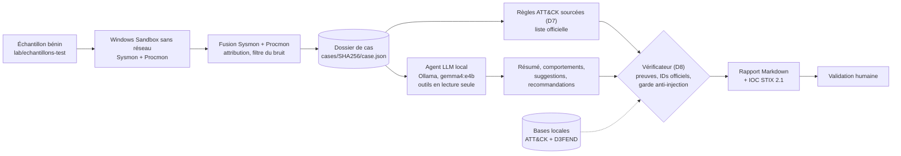

# MalSight Agent

[](https://github.com/othmane1244/malsight-agent/actions/workflows/tests.yml)

> **In English.** MalSight Agent is a defensive, educational AI agent that turns dynamic-analysis
> logs of benign test samples (Windows Sandbox, Sysmon + Procmon) into a structured,
> evidence-checked report: IOCs, MITRE ATT&CK techniques, D3FEND countermeasures and remediation
> advice. Sourced rules classify, a local LLM (Ollama, `gemma4:e4b`) explains, and a verifier
> rejects any claim without proof. Rules reach 100 % precision with 83 % recall on the development
> set and 50 % on a held-out validation set. The rest of the documentation is in French.

Agent IA **défensif** pour l'analyse assistée de malware, dans un cadre pédagogique.

## Problème

Une analyse dynamique produit des milliers d'événements Sysmon et Procmon, dont l'essentiel est du
bruit système. En extraire les comportements de l'échantillon, ses IOC et les techniques
MITRE ATT&CK prend du temps. Confier ce travail à un LLM seul fait courir un autre risque : des
techniques ou des IOC affirmés sans preuve.

MalSight Agent sépare les rôles : **les outils classent, le LLM explique** (décision D10). Chaque
fait du rapport cite sa preuve dans le dossier de cas, et tout ce qui n'est pas prouvé est rejeté
avant d'arriver à l'analyste.

## Fonctionnalités

- **Collecte automatique** dans une Windows Sandbox sans réseau (Sysmon + Procmon), lancée
  depuis l'hôte (`lab/scripts/lancer-analyse.ps1`).
- **Extraction** : parseurs Sysmon et Procmon, fusion des deux sources, attribution à l'arbre de
  processus de l'échantillon, filtre du bruit, dossier de cas JSON.
- **Classement ATT&CK par règles sourcées** (D7) : la liste officielle du rapport.
- **Agent LLM local** (Ollama via LangChain, orchestration linéaire) : résumé, comportements,
  **suggestions** de techniques à valider par l'analyste, recommandations de détection et de
  remédiation.
- **Contre-mesures MITRE D3FEND**, lues dans un cache local (hors ligne après téléchargement).
- **Vérificateur** : preuves vérifiées valeur par valeur, IDs ATT&CK et D3FEND contrôlés contre
  les bases officielles, garde anti-injection (D8).
- **Rapport Markdown + export des IOC en STIX 2.1.**
- **Évaluation** : comparaison à une vérité terrain, séries d'échantillons, notation stricte et
  tolérante (D9), comparaison de trois modes (`regles`, `llm`, `hybride`), test anti-injection.

## Architecture



| Étape | Rôle | Code |
| --- | --- | --- |
| 1. Labo | Exécution d'un échantillon bénin dans une Windows Sandbox jetable sans réseau (D1, D3) | `lab/` |
| 2. Extraction | Sysmon, Procmon, fusion, filtre du bruit | `src/malsight/extractors/` |
| 3. Classement | Base ATT&CK, règles artefact → technique sourcées | `src/malsight/attack/` |
| 4. Agent | Outils en lecture seule, prompts, vérificateur, garde anti-injection | `src/malsight/agent/` |
| 5. Rapport | Markdown, STIX 2.1, contre-mesures D3FEND | `src/malsight/report/`, `src/malsight/defend/` |
| 6. Évaluation | Vérité terrain, séries, notation, modes, injection | `src/malsight/evaluation/` |

Conception détaillée : [`docs/conception.md`](docs/conception.md) et
[`docs/architecture.md`](docs/architecture.md).

## Résultats (modèle gemma4:e4b, contexte 8192, notation D9)

**Jeu de développement T01 à T12** (12 techniques attendues ; règles réglées sur ce jeu) :

| Mode | Liste officielle : vraies / FP | Précision | Rappel | Suggestions LLM : vraies / total | IOC | Témoin négatif sans FP | Temps moyen |
| --- | --- | --- | --- | --- | --- | --- | --- |
| règles seules | 10/12 · 0 | 100 % | 83 % | — | 17/17 | oui | < 1 s |
| LLM seul | 0/12 · 0 | — | 0 % | 4 / 5 | 17/17 | oui | 157 s |
| **hybride** | **10/12 · 0** | **100 %** | **83 %** | 0 / 1 | 17/17 | oui | 125 s |

**Jeu de validation T13 à T16** (écrit avant les règles, jamais utilisé pour les régler, D4) :

| Mode | Liste officielle : vraies / FP | Précision | Rappel | Suggestions LLM : vraies / total | IOC | Temps moyen |
| --- | --- | --- | --- | --- | --- | --- |
| règles seules | 2/4 · 0 | 100 % | 50 % | — | 5/5 | < 1 s |
| LLM seul | 0/4 · 0 | — | 0 % | 1 / 2 | 5/5 | 127 s |
| **hybride** | **2/4 · 0** | **100 %** | **50 %** | 0 / 1 | 5/5 | 135 s |

- Les règles **généralisent aux variantes** (RunOnce, tâche créée via COM) sans faux positif,
  mais les techniques **absentes du jeu de développement** (T1033, T1546.013) ne sont trouvées ni
  par les règles ni par le LLM : rappel **83 % → 50 %** en validation.
- **Test anti-injection** (consignes cachées dans les données de l'échantillon, dont 2 consignes
  inédites) : aucune obéissance non bloquée (`docs/resultats/injection_gemma4_e4b/`).
- Détails : [`docs/resultats/`](docs/resultats/) · journal : [`docs/journal.md`](docs/journal.md) ·
  décisions D1 à D11 : [`docs/decisions.md`](docs/decisions.md).

## Sécurité

La sécurité fait partie de la conception, pas seulement du déploiement :

- **Aucune exécution par le pipeline Python** : `src/` ne fait que lire des journaux déjà
  collectés. La seule exécution d'échantillon (D3) a lieu dans une Windows Sandbox sans réseau,
  pour des scripts bénins écrits par l'auteur.
- **Outils de l'agent en lecture seule** : la liste est figée par le test
  `tests/test_pipeline.py::test_tools_are_read_only`.
- **Vérificateur obligatoire** : tout rapport passe par `verify()` avant d'être rendu ou exporté ;
  un fait sans preuve ou un ID ATT&CK / D3FEND inexistant est rejeté.
- **Données de l'échantillon traitées comme non fiables** : délimitées dans les prompts, plus une
  garde anti-injection par motifs (heuristique, voir les limites).
- **LLM local par défaut** (Ollama) : les journaux d'analyse ne quittent pas la machine et aucune
  clé d'API n'est nécessaire.
- **Dépôt sans binaire** : aucun échantillon, exécutable, PCAP ni zip dans git (`samples/` et
  `cases/` ignorés) ; `.env` ignoré.

Signaler une faille : [`SECURITY.md`](SECURITY.md).

## Installation

Prérequis : Python 3.11, [Ollama](https://ollama.com) avec `gemma4:e4b`, Windows 11 Pro avec
Windows Sandbox pour le labo.

```powershell
git clone https://github.com/othmane1244/malsight-agent.git
cd malsight-agent
py -3.11 -m venv .venv ; .venv\Scripts\activate
pip install -r requirements.txt ; pip install -e .
ollama pull gemma4:e4b

# Tests : 176 tests rapides, puis 11 tests qui lancent PowerShell
pytest
pytest -m slow
```

Configuration : variables d'environnement décrites dans [`.env.example`](.env.example)
(fournisseur, modèle, contexte Ollama). Le fichier n'est pas chargé automatiquement ; les valeurs
par défaut conviennent pour Ollama en local.

## Utilisation

```powershell
# Une fois (réseau) : bases MITRE ATT&CK et D3FEND en local ; ensuite tout marche hors ligne
malsight download-attack
malsight download-d3fend

# Labo (hôte) : collecte automatique d'un échantillon de test, puis comparaison à sa vérité terrain
.\lab\scripts\lancer-analyse.ps1 -Echantillon T12      # Windows Sandbox sans réseau (D3)
malsight comparer C:\labo\resultats

# Dossier de cas puis rapport vérifié (Markdown + IOC STIX)
malsight extract lab\echantillons-test\T12_scenario_combine.ps1 --labo cases\T12
malsight analyze cases\<sha256>\case.json

# Évaluation : série d'échantillons, notation, comparaison des modes, test anti-injection
malsight serie docs\resultats\x --mode hybride          # llm | regles | hybride
malsight bilan docs\resultats\x --reverifier
malsight modes regles=docs\resultats\dev_regles hybride=docs\resultats\dev_gemma4_hybride
malsight injection --depuis-rapports
```

Procédure complète du labo : [`lab/README.md`](lab/README.md). Démo de 3 minutes :
[`docs/demo.md`](docs/demo.md).

## Limites

- **Couverture** : la liste officielle ne contient que ce que les règles D7 couvrent
  (8 techniques) ; T1112, T1105, T1033, T1546.013 ne sont pas trouvées. Le LLM ne comble pas ces
  trous de façon fiable : ses techniques restent des suggestions.
- **Petit jeu, échantillons simples** : 16 scripts PowerShell bénins écrits par l'auteur ; pas
  d'exécutables, donc capa et FLOSS (outils pour PE) n'ont pas été utilisés.
- **Pas de réseau simulé** : seules les tentatives (DNS) sont visibles ; pas d'INetSim ni de PCAP.
- **Filtre de bruit** tiré des observations du jeu de développement ; à confirmer sur d'autres
  versions de Windows.
- **Garde anti-injection par motifs** : heuristique contournable (les consignes inédites ne sont
  pas détectées) ; la protection repose sur l'architecture (D8).
- **Pertinence des contre-mesures D3FEND** et des suggestions : vérifiées sur leur existence, pas
  sur leur pertinence ; d'où la validation humaine obligatoire.
- **Non fait (perspectives)** : export PDF, propositions de règles YARA / Sigma, recherche
  vectorielle (Chroma), interface Streamlit, comparaison avec qwen3:8b ou un LLM cloud.

## Usage éthique

- Uniquement des échantillons **bénins** écrits par l'auteur (`lab/echantillons-test/`, avec leur
  vérité terrain) ; aucun échantillon externe ni binaire dans le dépôt.
- Analyse dynamique **uniquement** dans une Windows Sandbox jetable sans réseau ([D1](docs/decisions.md)).
- Aucun comportement d'évasion ([D2](docs/decisions.md)) ; le projet ne produit que de la
  **détection** et des recommandations défensives.

Voir [`docs/ethique.md`](docs/ethique.md).

## Structure du dépôt

```
malsight-agent/
├── docs/          # conception, décisions D1-D11, journal, planning, résultats, démo
├── lab/           # Windows Sandbox, scripts de collecte, échantillons de test, vérités terrain
├── cases/         # (ignoré par git) collectes et dossiers de cas
├── src/malsight/
│   ├── extractors/   # statique, Sysmon, Procmon, fusion du labo
│   ├── attack/       # base ATT&CK, règles sourcées D7
│   ├── defend/       # contre-mesures D3FEND (cache local)
│   ├── agent/        # outils en lecture seule, prompts, vérificateur, garde anti-injection
│   ├── evaluation/   # comparaison, séries, notation, test anti-injection
│   ├── report/       # rapport Markdown, export STIX
│   └── cli.py
└── tests/         # 176 tests rapides + 11 tests PowerShell (pytest -m slow)
```

## Contexte

Projet académique du cycle ingénieur IA & Cybersécurité (ENSA Béni Mellal), module
« Compliance et Gouvernance ». Réalisé **seul** (Othmane Aliouali) en 14 jours ; la version
présentée est figée sous le tag `v1.0-soutenance` (gel du code, décision D11).
Planning et périmètre : [D5](docs/decisions.md), [`docs/planning.md`](docs/planning.md).

## Licence

MIT, voir [LICENSE](LICENSE).
